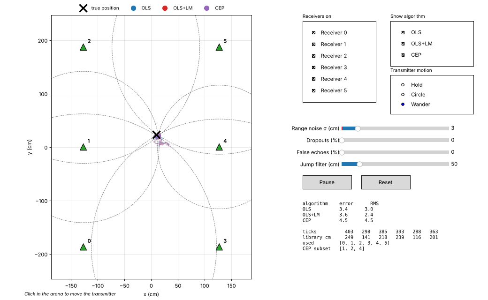

# UltraGPS positioning simulator

A small sandbox for the positioning maths. It fakes the six HC-SR04 receivers,
feeds their tick counts to the **same `ultragps_position` library**
ultragps-control uses, and plots what each algorithm makes of them. No ground
station or hardware needed.



## Running it

```bash
./install.sh                     # once, if you have not already
.venv/bin/python simulator/sim_gui.py
```

It only needs NumPy, SciPy and Matplotlib, and finds the library in `libs/` on
its own, so `python3 simulator/sim_gui.py` works from any environment that has
those three. Options: `--config path/to/config.toml` (default:
`config/config.toml`) and `--seed N` for a repeatable run.

For a quick numbers-only comparison, with no window:

```bash
python3 simulator/sim_core.py
```

## What you can do

- **Move the transmitter**: click in the arena, or pick *Circle* / *Wander*.
- **Switch receivers off**: an off receiver reports tick `0`, which is what
  the base-station firmware sends when it hears no echo.
- **Add faults** to every reading:
  - *Range noise*: Gaussian jitter on each range, in cm.
  - *Dropouts*: chance a reading has no echo (tick `0`).
  - *False echoes*: chance a reading is a random range (multipath, a
    reflection off a wall).
- **Tune the jump filter**: the library's `max_differential`.
- **Compare algorithms**, each straight from the library:

| Algorithm | What it is |
|-----------|------------|
| OLS | Linear least squares: the library's seed estimate |
| OLS+LM | OLS refined by Levenberg-Marquardt (`lm_position`) |
| CEP | Best receiver subset by CEP radius (`cep_position`) |

The readout shows each algorithm's current and rolling RMS error, the raw
ticks, the distances the library computed, which receivers its sanity filter
kept, and the subset CEP picked. Receiver markers are green when used, orange
when the filter rejected them, and grey when switched off.

## How it works

Two files, nothing else:

- `sim_core.py`: `SensorModel` turns a true position into ticks by inverting
  each receiver's calibration from `config.toml`
  (`tick = (range - intercept) / slope`), then applies the faults.
  `solve_all()` calls `get_position_full()`, exactly as the position panel
  does, and adds the library's OLS seed on the same filtered receivers.
- `sim_gui.py`: the Matplotlib window and its controls.
